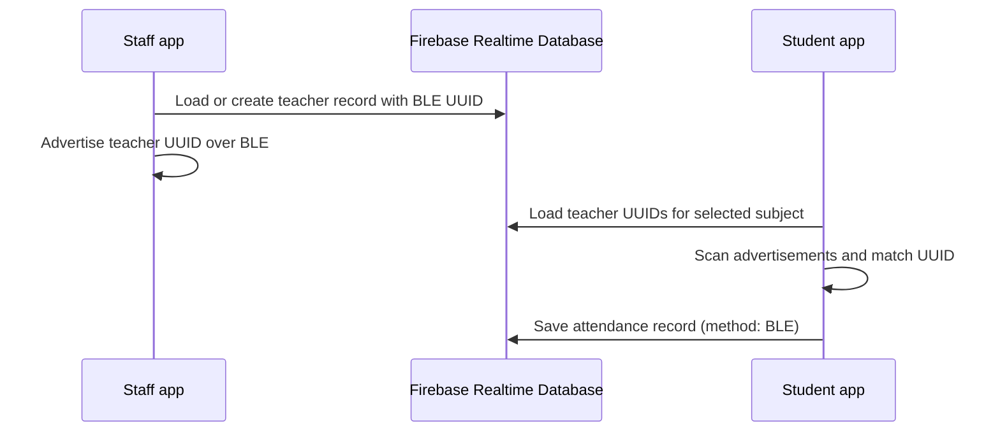
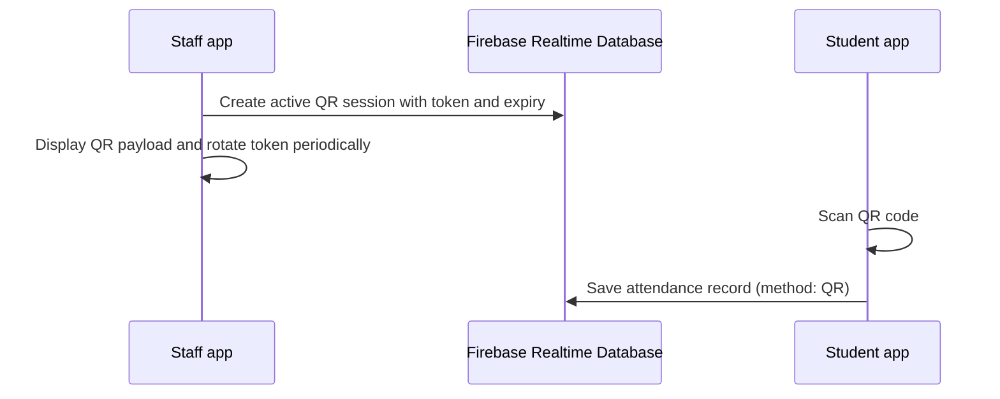
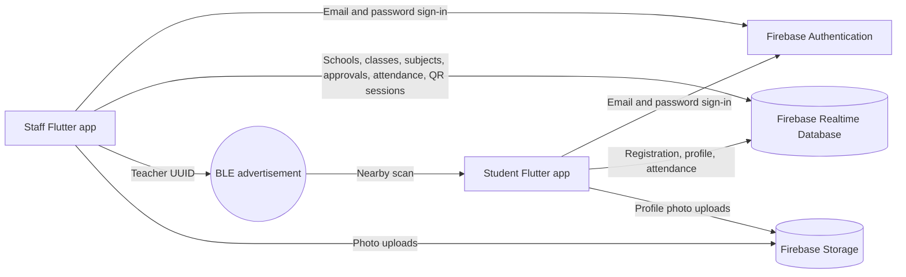

<p align="center">
  
</p>

<h1 align="center">Smart Attendance System</h1>

<p align="center">
  A Flutter attendance platform that connects student check-in with teacher BLE broadcasts, QR scanning, and Firebase-backed records.
</p>

<p align="center">
  <a href="https://github.com/moinshaikh6249/smart-attendance-system"></a>
  
  
  
  
</p>

## Project Overview

Smart Attendance System is a pair of Flutter mobile applications for recording attendance using nearby teacher Bluetooth Low Energy (BLE) broadcasts or QR scanning. Firebase Authentication, Realtime Database, and Storage provide sign-in and cloud-backed app data.

The repository contains a staff-facing admin application and a student application. Attendance records include the student identifier, school, class, subject, date, timestamp, and attendance method.

## About the Project

The project explores a mobile-first workflow for attendance management: staff can manage student approvals and attendance, while students can register, view attendance information, and use the available check-in flows. BLE scanning identifies a configured teacher UUID; the student app also includes a QR scanner as an alternative.

> **Scope note:** QR scanning and BLE proximity are convenience signals, not proof of identity or presence. Neither method guarantees that proxy attendance is prevented.

## Key Features

| Area | Implemented functionality |
|---|---|
| BLE attendance | Teacher app advertises its stored BLE UUID; the student app scans for configured teacher UUIDs and records a BLE attendance entry when detected. |
| UUID identification | UUID v4 identifiers are used for student records and persistent teacher BLE identification. |
| QR attendance | Staff app can display a live QR payload with a rotating token; student attendance UI includes a QR scanner and records the QR method. See [QR workflow](#qr-attendance-workflow) for an important validation limitation. |
| Student management | Student registration requests are stored for approval; staff can review approvals and search student records. |
| Teacher functionality | A signed-in staff account can load or create a teacher record and start or stop BLE broadcasting. |
| Admin dashboard | The staff app includes a dashboard, school/class/subject selection, student approvals, attendance tools, settings, and profile screens. |
| Firebase integration | Firebase Authentication, Realtime Database, and Firebase Storage are used by the applications. |
| Attendance records | Records are organized by school, class, subject, date, and student UUID, with method and timestamp fields. |
| Excel export | Staff can export attendance data as an `.xlsx` workbook. |
| Student history | The student app includes attendance history and profile screens. |

## How the System Works

1. Staff and student apps connect to the configured Firebase project.
2. Student registration submits a UUID-based profile request for staff approval.
3. Staff selects the relevant school, class, and subject.
4. The student checks in through BLE scanning or the QR attendance screen.
5. The app writes attendance records to Firebase Realtime Database; the staff app can export attendance to Excel.

### BLE Attendance Workflow



The BLE service checks the required Bluetooth permissions and adapter state. The student scanner checks BLE service UUIDs and manufacturer data formats used by the app.

### QR Attendance Workflow



**Current implementation limitation:** The staff app writes a session token, active state, and expiry to the database and includes session context in the QR payload. The student attendance screen currently records attendance after receiving a non-empty scan; it does not compare the scanned token with the active Firebase session or enforce its expiry. Do not treat this QR flow as validated authorization or an anti-proxy measure.

## System Architecture



Firestore is **not** used by the inspected application code. Firebase Realtime Database is the database implementation.

### Data Areas

The service code reads and writes data under paths including:

| Realtime Database path | Purpose |
|---|---|
| `schools`, `classes`, `subjects` | School and academic selection data |
| `students` | Approved student records |
| `pending_approvals` | Student registration requests awaiting staff review |
| `teachers` | Teacher profile and persistent BLE UUID |
| `attendance/{school}/{class}/{subject}/{date}/{student}` | Attendance records |
| `qr_sessions/{school}/{class}/{subject}/current` | Staff-generated QR session state |

## Technology Stack

| Technology | Use |
|---|---|
| Flutter and Dart | Android/iOS application UI and application logic |
| Firebase Authentication | Email/password sign-in |
| Firebase Realtime Database | Student, school, class, subject, teacher, attendance, and QR session data |
| Firebase Storage | Photo uploads |
| Bluetooth Low Energy | Teacher UUID broadcasting and student-side scanning |
| UUID | Student IDs and teacher BLE identifiers |
| QR Code | QR generation in the staff app and scanning in the student app |
| Provider | State management |
| `excel` | `.xlsx` attendance export |
| Git and GitHub | Source control and repository hosting |

## Project Folder Structure

```text
smart-attendance-system/
├── README.md
└── BLE MARK/
    └── rtccs_admin/
        ├── pubspec.yaml
        ├── assets/
        │   └── images/
        │       └── logo.png
        ├── lib/
        │   ├── main.dart
        │   ├── models/
        │   ├── providers/
        │   ├── screens/
        │   ├── services/
        │   └── widgets/
        └── rtccs_student/
            ├── pubspec.yaml
            └── lib/
                ├── main.dart
                ├── config/
                ├── models/
                ├── providers/
                ├── screens/
                ├── services/
                └── widgets/
```

The nested `rtccs_admin` folder is the staff/admin Flutter app; `rtccs_student` is a separate Flutter app nested within it. Each has its own `pubspec.yaml` and platform folders.

## Installation Requirements

- Flutter SDK with Dart **3.8.1 or later** (both package manifests specify `sdk: ^3.8.1`).
- Git.
- Android Studio and Android SDK for Android builds, or Xcode on macOS for iOS builds.
- A Firebase project configured for the services listed in [Firebase Configuration](#firebase-configuration).
- BLE-capable devices and required permissions to test BLE advertising or scanning. QR scanning requires camera permission.

## Step-by-Step Setup

1. Clone the repository:

   ```bash
   git clone https://github.com/moinshaikh6249/smart-attendance-system.git
   cd smart-attendance-system
   ```

2. Configure Firebase for the app(s) you intend to run. See [Firebase Configuration](#firebase-configuration).

3. Fetch dependencies for the staff/admin app:

   ```bash
   cd "BLE MARK/rtccs_admin"
   flutter pub get
   ```

4. Start the staff/admin app on a connected device or emulator:

   ```bash
   flutter run
   ```

5. To run the student app, open a second terminal at the repository root and run:

   ```bash
   cd "BLE MARK/rtccs_admin/rtccs_student"
   flutter pub get
   flutter run
   ```

Use physical BLE-capable devices for end-to-end BLE testing; emulator BLE behavior can differ from real hardware.

## Firebase Configuration

The two Flutter apps initialize Firebase differently: the staff app uses the platform's default Firebase initialization, while the student app uses `DefaultFirebaseOptions.currentPlatform`. Configure each app against a Firebase project you control and provide the matching platform configuration before building.

1. Create or select a Firebase project and register the Android/iOS app identifiers used by your builds.
2. Enable **Email/Password** in Firebase Authentication.
3. Create a **Realtime Database** and configure its security rules for authenticated, authorized access.
4. Enable **Firebase Storage** if photo upload functionality is required.
5. Add or generate the platform configuration for each app. For the student app, configure its `DefaultFirebaseOptions` for the target platform; for the staff app, use the standard native Firebase configuration expected by its initialization code.
6. Confirm the selected Firebase project is the intended development/test project before running the apps.

Do not add service-account private keys, passwords, access tokens, or other credentials to source control or this README. Firebase client configuration is not a substitute for restrictive Realtime Database and Storage rules.

## Running the Application

- Run the staff/admin app from `BLE MARK/rtccs_admin`.
- Run the student app from `BLE MARK/rtccs_admin/rtccs_student`.
- Sign-in uses Firebase Authentication email/password accounts configured in the selected Firebase project.
- BLE attendance requires Bluetooth and platform permissions; teacher broadcasting and student scanning should be tested on compatible devices.
- QR scanning requires camera permission. The current QR attendance limitation is described above.

The repository does not include a root-level Flutter package; run Flutter commands from one of the two app directories.

## Security and Data Integrity

- Firebase Authentication handles email/password sign-in, while Realtime Database stores application records.
- Configure and test Firebase Database and Storage rules for least-privilege access before using real student data. Client-side checks alone do not provide authorization.
- Attendance records are organized by school, class, subject, date, and student UUID and include an attendance method and timestamp.
- The manual staff attendance flow skips a student already marked for the selected date, class, and subject. Database rules should independently enforce appropriate write access and duplicate/data-integrity requirements.
- QR session token and expiry values are generated by the staff app, but the student attendance screen does not currently validate them before recording a QR check-in.
- BLE UUID detection indicates that an advertisement was observed nearby; it does not establish a student's identity or guarantee physical presence.
- Neither BLE nor QR attendance completely prevents proxy attendance. Review and reconcile records using appropriate institutional procedures.

## Project Objectives

- Make attendance workflows accessible through dedicated staff and student apps.
- Explore nearby-device BLE identification as one attendance method.
- Provide QR scanning as an alternate check-in interaction.
- Organize attendance information by school, class, subject, date, and student.
- Support staff review of student registration requests and Excel export of attendance.

## Challenges and Solutions

| Engineering consideration | Implemented approach |
|---|---|
| BLE access varies by device and OS version | BLE services request platform permissions and check adapter state before advertising or scanning. |
| BLE identifiers need a consistent representation | UUID strings are normalized and converted to/from 16-byte manufacturer data; the scanner also checks service UUIDs. |
| School attendance is scoped to an academic context | Records and lookups use school, class, subject, date, and student identifiers. |
| QR may be unavailable or unsuitable for a check-in | The student app provides a camera-based QR scanner alongside BLE attendance. QR session verification remains a future improvement. |

## Future Enhancements

These are not claimed as completed features:

- Validate QR tokens, active session state, and expiry before accepting student check-ins; enforce the validation with trusted server-side logic.
- Define and test Firebase security rules and role-based authorization for every data path.
- Add automated tests for attendance uniqueness, registration approval, QR validation, and BLE identifier parsing.
- Improve reporting filters and attendance analytics beyond the currently available dashboard and Excel export.
- Review optional student modules before enabling them; several are disabled by default in the feature flags.

## Developer Information

**Moin Shaikh**<br>
Flutter Developer

- **GitHub:** [moinshaikh6249](https://github.com/moinshaikh6249)
- **Portfolio:** [moin-shaikh-portfolio.vercel.app](https://moin-shaikh-portfolio.vercel.app/)

## GitHub Repository

[github.com/moinshaikh6249/smart-attendance-system](https://github.com/moinshaikh6249/smart-attendance-system)

## Portfolio

[Visit Moin Shaikh's portfolio](https://moin-shaikh-portfolio.vercel.app/)

## Closing

Smart Attendance System brings together Flutter, Firebase, BLE, and QR scanning in a practical exploration of digital attendance workflows. The repository is structured for continued development, with clear opportunities to strengthen validation, authorization, and reporting as the project evolves.

---

<p align="center">Built with Flutter by <strong>Moin Shaikh</strong></p>
